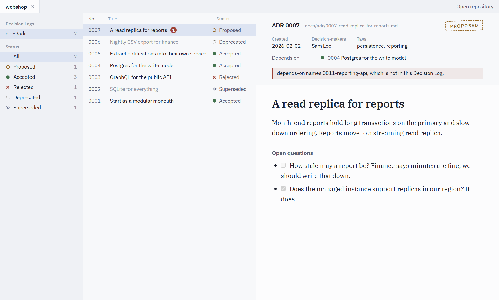

# ADR Tool

A desktop application for browsing, writing and relating the Architecture Decision Records that live in a git repository. Working title; early development.



## Documents

- [CONTEXT.md](CONTEXT.md) — the domain language. Code uses these terms.
- [docs/adr/](docs/adr/) — the decisions this project rests on, written in the tool's own format.
- [docs/plan.md](docs/plan.md) — milestones towards v1.
- [docs/roadmap.md](docs/roadmap.md) — what is in v1 and what comes after.
- [docs/vision.md](docs/vision.md) — where the project is heading: the ADR tool as the first module of an architect's suite. Its vocabulary is mapped in [CONTEXT-MAP.md](CONTEXT-MAP.md).

## Development

Requires Node 22.12 or newer and pnpm 11.

```bash
pnpm install
```

```bash
pnpm dev
```

The app reopens the repositories of the last run. To see every Status, Relations and a Problem at once, open the showcase Decision Log in `packages/core/test/fixtures/showcase`.

`pnpm test`, `pnpm typecheck`, `pnpm lint`, `pnpm format:check` and `pnpm build` are what CI runs on Windows, macOS and Linux.

## Layout

- `packages/core` — the domain core in pure TypeScript. No Electron, no DOM, no disk access of its own; its type check fails if it reaches for any of them.
- `packages/app` — the Electron + Svelte 5 desktop app. The renderer is sandboxed and talks to the main process only through the preload bridge.

Prettier never formats Markdown in this repository, and the fixtures under `packages/core/test/fixtures` are exempt from git's line-ending normalization: the tool promises never to change a byte it was not asked to change ([ADR-0002](docs/adr/0002-never-reserialize-markdown.md)), and its own repository is its first test case.
