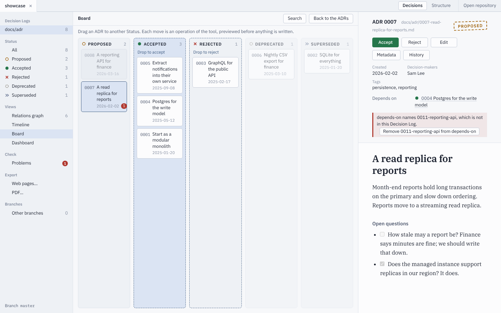
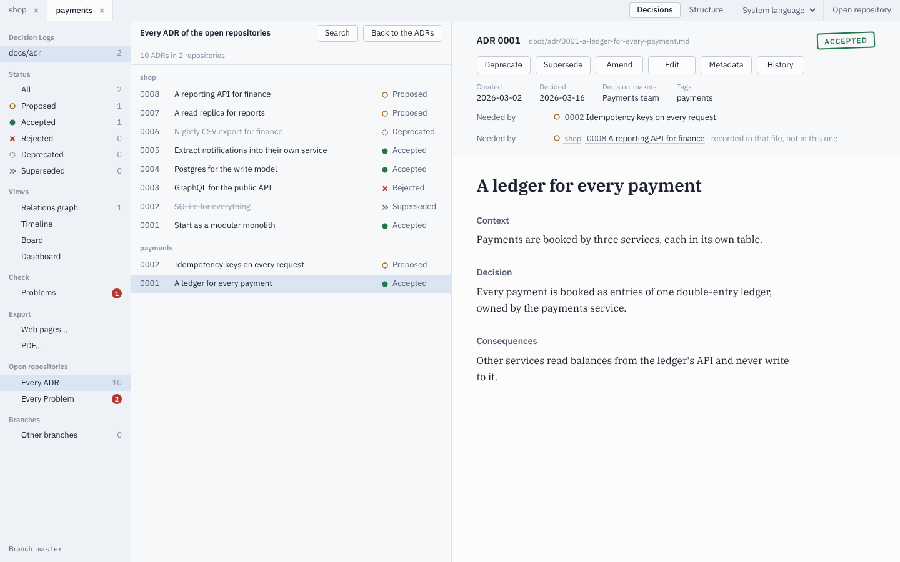
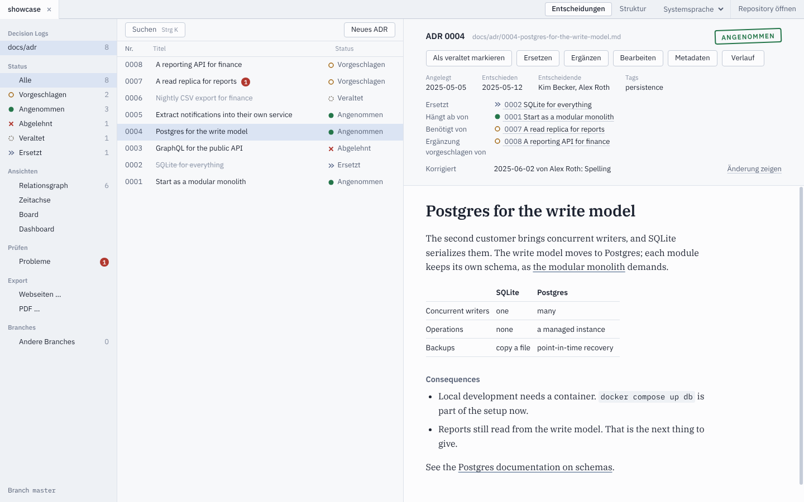
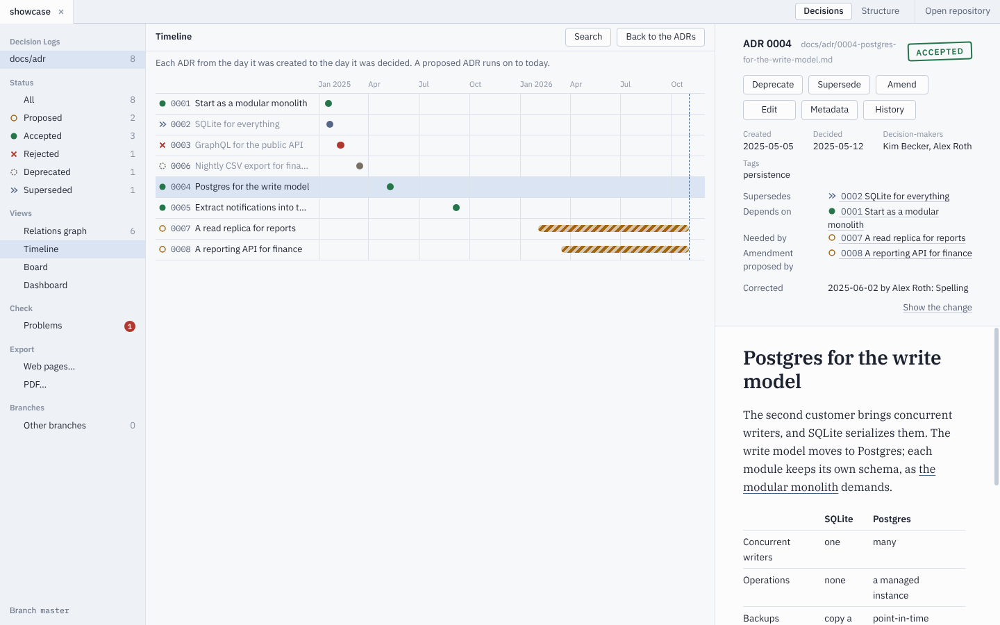
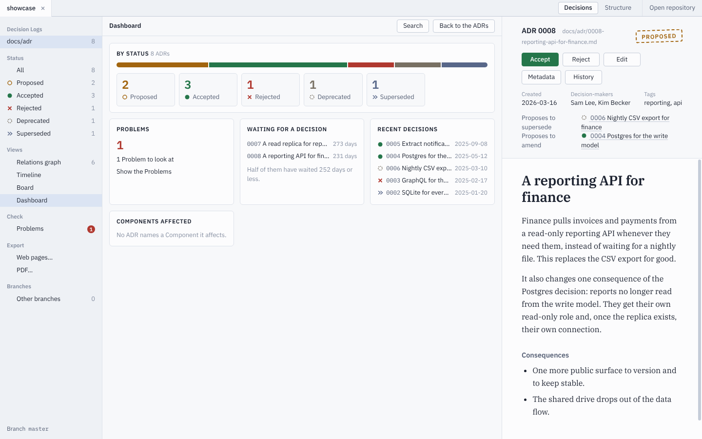

# Softarch Suite

[](https://github.com/CyphraX/adr-tool/actions/workflows/ci.yml)


[](LICENSE)

A desktop app for the architecture that lives in a git repository: its Architecture Decision Records, and the structure of its code.

<picture>
  <source media="(prefers-color-scheme: dark)" srcset="docs/screenshots/readme/decisions-dark.png">
  
</picture>

Softarch Suite reads ADRs where they already are: Markdown files in a repository, written by people, by agents or by other tools. It lists them, shows how they relate, finds what is inconsistent, and writes new ones and changes to existing ones. Every change is shown as a diff before it is written, and nothing is changed beyond the lines it was asked to change. Markdown is never re-serialized ([ADR-0002](docs/adr/0002-never-reserialize-markdown.md)).

The suite is planned as one workbench of several modules for software architects ([vision](docs/vision.md)). Two of them are built:

- **Decisions** covers the ADRs. It was called ADR Tool until the suite got its name.
- **Structure** shows the Components of the code and the Dependencies between them, and links them to the ADRs that affect them.
- **Conformance** checks the code against Rules the architect writes down. Its core and `adr check` are built; its window is next.

The app runs locally: there is no backend, no account and no telemetry.

> [!NOTE]
> Early development. The Decisions and Structure modules are built, and so is the rest of the roadmap; the other modules of the suite are being built part by part ([plan-vision.md](docs/plan-vision.md)). There are no installers yet: the app runs from source.

## Table of Contents

- [Features](#features)
  - [Decisions](#decisions)
  - [Structure](#structure)
  - [Conformance](#conformance)
- [Install](#install)
- [Usage](#usage)
  - [Checking ADRs in CI](#checking-adrs-in-ci)
  - [Checking the code against its Rules](#checking-the-code-against-its-rules)
  - [Agents over MCP](#agents-over-mcp)
- [Development](#development)
- [Documentation](#documentation)
- [Roadmap](#roadmap)
- [Contributing](#contributing)
- [License](#license)

## Features

### Decisions

- **Browse.** The app opens one tab per repository and finds every Decision Log in it. You can filter the ADRs by Status: proposed, accepted, rejected, deprecated or superseded. Each ADR shows its Metadata, its Relations and its Back-references, and its text is rendered.
- **Relations graph.** It shows which ADR supersedes, amends, depends on or relates to which. An ADR stands to the right of what it builds on. A Relation can lead into another Decision Log of the repository, written `docs/adr/0002-…`; the graph draws that ADR with a dashed border. The graph zooms with its buttons, to fit the pane, and with <kbd>Ctrl</kbd> (<kbd>⌘</kbd> on a Mac) and the mouse wheel about the point under the cursor. The check boxes of its legend show or hide each Relation type, and an ADR left without a Relation that is shown drops out unless it is selected. A screen reader reads each line out as a sentence — "ADR 0004 (Postgres for the write model) supersedes ADR 0002 (SQLite for everything)" — and <kbd>Tab</kbd> goes from box to box.

  

- **Write.** You can create a new ADR from a Template: `minimal`, `nygard`, `madr` or the repository's own. You can Accept, Reject, Deprecate, Supersede, Amend and Renumber. Every operation returns a change set, and you see that change set as a diff of every file it touches before anything is written ([ADR-0004](docs/adr/0004-operations-return-change-sets.md)). A change set is written all of it or nothing: when the disk refuses a step, every file stays as it was ([ADR-0015](docs/adr/0015-a-change-set-is-written-beside-its-files-and-renamed-into.md)).

  

- **Timeline, board and dashboard.** The **Timeline** shows each ADR from the day it was created to the day it was decided. The **Board** has a column per Status: dragging an ADR to another column accepts, rejects, deprecates or supersedes it, through the same preview as anywhere else. The **Dashboard** counts the ADRs by Status, shows the Problems, how long proposals have waited, the latest decisions and the Components the ADRs affect.

  

- **Edit.** The editor has three modes: the Markdown source on its own, the source with a live preview, and **Live**, which renders headings, emphasis, links, lists, code and tables in place and shows the source of the line the cursor is in. Every mode saves the same text. Once an ADR is decided, saving records a **Correction**. A Correction never changes what was decided.

  

  

- **Problems and Repairs.** The tool finds broken Relations, inconsistent Back-references, duplicate numbers and invalid Metadata. Where it can know what was meant, a Problem comes with a Repair, which is previewed like any other change. What only follows from a file that cannot be read, or from a Status that is none of the five values, is listed under that root cause.

  

- **Search.** <kbd>Ctrl</kbd> <kbd>K</kbd> (<kbd>⌘</kbd> <kbd>K</kbd> on a Mac) searches the full text instantly: number, title and body, in every repository that is open. It ignores case and accents, and reads "ß" as "ss": "strasse" finds "Straße".
- **Several repositories.** Each repository opens in a tab of its own. With more than one open, **Every ADR** and **Every Problem** list them together, and an ADR may depend on or relate to an ADR of another repository, written `payments:docs/adr/0001-ledger`; where both are open, the Relation reads as such from both ends.

  

- **git.** The app shows the branch that is checked out and the ADRs with uncommitted changes. For each ADR it shows its history, commit by commit, with the diff; while the history is open, it follows the file and git. **Commit** commits an ADR's file — and, if you like, those of the ADRs it supersedes or amends — with a message you see and can change. Nothing else that is changed or staged is taken along, and nothing is pushed ([ADR-0012](docs/adr/0012-committing-an-adr-runs-git-commit-for-its-files-only.md)). **Other branches** lists the ADRs that branches which are not checked out add or decide, read from git without checking anything out, and a new ADR warns when another branch has given its number away already.
- **Export.** **Export → Web pages…** writes the Decision Logs as HTML pages for people who do not use the tool: an index by Status and a page per ADR, with its Relations as links. The pages open from disk, from a file share or from any web host. They run no script and fetch nothing. **PDF…** prints the same ADRs as a PDF, one ADR per page ([ADR-0014](docs/adr/0014-the-export-is-static-html-from-core-printed-to-pdf-by.md)).
- **Foreign formats.** ADRs written for [MADR](https://adr.github.io/madr/) 2, 3 and 4, for [log4brains](https://github.com/thomvaill/log4brains) and for [adr-tools](https://github.com/npryce/adr-tools) are read as they are. **Migration** converts them into the suite's own format, as a previewed change ([ADR-0005](docs/adr/0005-foreign-formats-are-read-never-written.md)).
- Light and dark themes, following the system.
- **English and German.** The window speaks German when the system does, and English otherwise; the menu at the top right overrides that. What the tool says about ADRs and code — Problems, refusals, the warnings of a change — is said in the same language. `adr lint`, `adr check` and the MCP server stay English.

  

<details>
<summary>More screenshots: timeline, dashboard, Metadata, search, history, Migration</summary>






</details>

### Structure

- **Components.** Components are declared in `.arch/components.yml`. Until something is declared, the app derives a **Draft** from the build files and the folders: pnpm and npm workspaces, Maven modules, Gradle projects. The Draft is marked as a proposal everywhere it is shown, and **Adopt** writes it as a previewed change.

  

- **Dependencies and Cycles.** The app reads TypeScript, JavaScript, Svelte and Java with parsers alone. It never runs anything from the repository it analyses ([ADR-0007](docs/adr/0007-the-analysis-never-executes-anything-from-the-analysed.md), [ADR-0008](docs/adr/0008-dependencies-come-from-parsers-alone-without-a-type-checker.md)). Each level is drawn as a graph. A Cycle is shown with an example round trip and its weakest Dependency.

  

- **Dependency structure matrix.** Each row shows the Dependencies of one Component, and what lies above the diagonal closes a Cycle. A row expands into the parts of its Component.

  

- **Metrics.** The metrics table shows, for each Component:
  - size: Source Files and lines;
  - efferent and afferent coupling;
  - instability;
  - fan-out and fan-in;
  - relational cohesion;
  - internal share.

  Each metric has its definition on its column heading.

  

- **From a line to the code.** Click a line in the graph, then one of its line numbers. The Source File opens in a read-only viewer, with the import behind the Dependency marked.

  

- **As deep as the folders go.** Below a Component without children, the levels continue through its directories down to single files. Each directory has its own graph, matrix row, metrics and page. Directories are part of the view only: nothing declares them, and nothing writes them.

  

- **Traces and Rename.** An ADR names the Components it affects. The page of a Component lists those ADRs ([ADR-0009](docs/adr/0009-traces-are-recorded-on-the-source-only-unlike-back.md)). **Rename** gives a Component a new name and rewrites the declaration and every ADR that names it in one previewed change.

  

The analysis runs in a worker thread and caches its results per file. It follows changes on disk while the view is open.

### Conformance

- **Rules and Exceptions.** `.arch/rules.yml` says what the code may look like: which Component must not depend on which, which may only depend on which, which layers stand over which, where no Cycle may be, and how far a metric may go. Each Rule says why it holds. A Violation the architect accepts is written down as an Exception next to the Rules, with its reason and the ADR that justifies it, and it keeps matching when the code around the import moves ([ADR-0017](docs/adr/0017-rules-and-exceptions-share-one-file-keyed-by-fingerprint.md)). `adr check` checks them in CI and puts each Violation on the line of its import in a pull request; the window follows ([plan-vision.md](docs/plan-vision.md), part 4).

## Install

Requirements:

- [Node.js](https://nodejs.org/) 22.12 or newer.
- [pnpm](https://pnpm.io/) 11. With `corepack enable`, the version pinned in `package.json` is used.
- git, optional. Without it, the history and the uncommitted changes are not shown.

```bash
git clone https://github.com/CyphraX/adr-tool.git
cd adr-tool
pnpm install
```

`pnpm install` also downloads Electron. CI builds and tests on Linux. Windows and macOS are switched off in CI until distribution (see the [roadmap](docs/roadmap.md)).

## Usage

Start the app in development mode:

```bash
pnpm dev
```

**Open repository**, at the top right, opens the folder of a repository in a new tab. Each tab switches between **Decisions** and **Structure**. On the next start, the app reopens the repositories of the last run.

`ADR_TOOL_REPO` opens one more repository at start. Give it the full path, because `pnpm dev` runs in `packages/app`:

```bash
ADR_TOOL_REPO="$PWD/packages/core/test/fixtures/showcase" pnpm dev
```

### Checking ADRs in CI

`adr lint` checks the Decision Logs of a repository by the same rules as the app, without the window. It prints each Problem with its file, line and code, and exits with 1 when there is one:

```console
$ pnpm build
$ node packages/cli/dist/adr.mjs lint packages/core/test/fixtures/broken
docs/adr/0004-api-style.md:2: status-not-lowercase: The Status is written "Rejected". It has to be lowercase.
docs/adr/0003-new-database.md:6: unknown-target: depends-on names 0042-never-written, which is not in this Decision Log.
…

10 Problems in 1 Decision Log.
```

The command is one file with nothing beside it, for any repository: `--format github` puts each Problem on its line of a pull request, and `--format json` is for machines. This repository runs `adr check`, which does the same and checks its Rules too, on itself in CI. The contract — what it prints, the codes, the exit codes — is [docs/cli.md](docs/cli.md).

### Checking the code against its Rules

`adr check` does what `adr lint` does, and checks `.arch/components.yml` and the Rules of `.arch/rules.yml` against the code. Each Violation is printed at the line of the import that causes it, with the reason its Rule gives; the command exits with 1 on a Problem or on a Violation without an Exception:

```console
$ node packages/cli/dist/adr.mjs check packages/conformance/test/fixtures/layered-shop
src/billing/invoice.ts:3: billing-not-web: billing must not depend on web: src/billing/invoice.ts:3 imports src/web/format.ts. Billing is the domain; the web is how it is shown, and may change without it.
src/billing/invoice.ts:3: layered: billing must not depend on web, which lies in a layer above it: src/billing/invoice.ts:3 imports src/web/format.ts. The web uses billing, which uses persistence.

No Problems in 1 Decision Log.
2 Violations of 2 Rules.
```

It reads TypeScript, JavaScript and Java, and runs nothing from the repository. This repository checks its own packages with it in CI ([.arch/rules.yml](.arch/rules.yml)). The command is in [docs/cli.md](docs/cli.md#adr-check-path---format-textjsongithub), the file of Rules in [docs/conformance-format.md](docs/conformance-format.md).

### Exporting for readers

`adr export` writes the same pages as the app's **Export**, into a directory of your choice. It writes only into an empty directory or over an earlier export:

```console
$ node packages/cli/dist/adr.mjs export --out ../decisions
Exported 14 ADRs of 1 Decision Log to /home/me/decisions. Open /home/me/decisions/index.html.
```

`--log docs/adr` limits the export to one Decision Log. What it writes is described in [docs/cli.md](docs/cli.md#adr-export-path---out-directory---log-directory).

### Agents over MCP

`adr-mcp` serves the Decision Logs of a repository to an agent over the [Model Context Protocol](https://modelcontextprotocol.io). The agent reads ADRs, Problems and Templates, and writes through the same operations as the app — create, accept, edit, repair, migrate — each planned first and answered as diffs. Nothing is written until `apply_change`, so the person sees every change before it lands ([ADR-0013](docs/adr/0013-agents-write-adrs-through-the-mcp-server-as-previewed-change.md)).

```console
$ pnpm build
$ claude mcp add softarch -- node "$PWD/packages/mcp/dist/adr-mcp.mjs" .
```

Any client that starts a server as a process works the same way. The tools and what they answer are in [docs/mcp.md](docs/mcp.md).

### Sample repositories

The test fixtures are useful for exploring the app. They are test data, so copy one before you try anything that writes.

| Path | What it shows |
| --- | --- |
| `packages/core/test/fixtures/showcase` | Every Status, supersedes, amends and depends-on, and one Problem |
| `packages/core/test/fixtures/broken` | Ten Problems, each with its Repair |
| `packages/core/test/fixtures/madr`, `…/madr-2`, `…/log4brains`, `…/adr-tools` | Foreign formats, offered for Migration |
| `packages/structure/test/fixtures/shop` | A Cycle between two Components with its weakest Dependency, and one between two files |
| `packages/structure/test/fixtures/maven-shop` | Java: a Maven project of three modules, with one package spread over two of them |
| `packages/conformance/test/fixtures/layered-shop` | Three layers and two Rules, broken on purpose by one import, and the ADR an Exception for it would name |
| this repository | Its own ADRs, and its packages as declared Components |

### Where ADRs are found

The app looks in the following places, in this order, and stops at the first one that has anything:

1. `.adr/config.yml`
2. adr-tools' `.adr-dir`
3. the folders `docs/adr`, `doc/adr` and `docs/decisions`

Opening a repository never writes anything. The first ADR of a repository goes into `docs/adr`.

An ADR is a Markdown file with its Metadata in front matter:

```markdown
---
status: accepted
created: 2025-05-05
decided: 2025-05-12
decision-makers: [Kim Becker, Alex Roth]
supersedes: [0002-sqlite-for-everything]
affects: [billing]
---

# Postgres for the write model

The second customer brings concurrent writers, and SQLite serializes them. …
```

The complete contract, including Templates, every operation and the foreign formats, is [docs/file-format.md](docs/file-format.md). It is written so that people and agents can write valid ADRs without the app.

### Declaring Components

```yaml
# .arch/components.yml
components:
  core:
    name: Domain core
    paths: [packages/core/src/**]
    components:
      metadata:                 # Component ID: core/metadata
        paths: [packages/core/src/metadata/**]
  app:
    paths: [packages/app/src/**]
```

The patterns, test files, the Draft, the Dependencies of each language and the definitions of the metrics are in [docs/structure-format.md](docs/structure-format.md).

### Writing Rules

```yaml
# .arch/rules.yml
rules:
  - id: billing-not-web
    why: Billing is the domain; the web is how it is shown, and may change without it.
    kind: must-not-depend
    from: billing
    to: [web]

exceptions:
  - rule: billing-not-web
    from: billing
    to: web
    reason: The invoice formats its date like the web until it has a format of its own.
    justified-by: docs/adr/0012-invoices-format-dates-like-the-web
```

The kinds of Rules, the fingerprint an Exception names and the Problems of the file are in [docs/conformance-format.md](docs/conformance-format.md).

## Development

| Command | What it does |
| --- | --- |
| `pnpm dev` | Runs the app with hot reload |
| `pnpm build` | Builds every package |
| `pnpm test` | Runs every package's tests with Vitest |
| `pnpm typecheck` | Runs `tsc`, and `svelte-check` for the renderer |
| `pnpm lint` | Runs ESLint |
| `pnpm format` / `pnpm format:check` | Runs Prettier, writing or checking |
| `pnpm adr lint` | Checks this repository's ADRs with the built command line |
| `pnpm adr check` | Checks them too, and this repository's code against `.arch/rules.yml` |
| `pnpm adr export --out <dir>` | Exports this repository's ADRs as HTML pages |

CI runs `lint`, `format:check`, `typecheck`, `test` and `build` on every pull request, then `adr check` on the repository itself: its Decision Log, its declaration of Components, and its code against `.arch/rules.yml`.

### Project layout

A pnpm monorepo. Each module of the suite has one UI-free core package. The module cores depend on the kernel and may depend on Structure's model, whose Components every module refers to; otherwise they never depend on each other ([ADR-0006](docs/adr/0006-one-core-package-per-module-on-a-shared-kernel.md)).

| Package | Contents |
| --- | --- |
| [`packages/kernel`](packages/kernel) | What every module needs and none owns: the file-system port, splice edits, change sets |
| [`packages/core`](packages/core) | The core of the Decisions module in pure TypeScript. No Electron, no DOM and no disk access of its own; its type check fails if it reaches for any of them |
| [`packages/structure`](packages/structure) | The core of the Structure module, under the same guard: Components, Source Files, the Draft, Dependencies, Cycles, the metrics and the matrix. Java is read with `tree-sitter-java` as WebAssembly. Its entry `@adr-tool/structure/model` holds everything except the parsers |
| [`packages/conformance`](packages/conformance) | The core of the Conformance module, on `kernel` and `structure` alone and under the same guard: the Rules and Exceptions of `.arch/rules.yml`, their evaluation against the Dependencies, the Problems of the file, and Rename in it |
| [`packages/cli`](packages/cli) | The command line, `adr lint`, `adr check` and `adr export`, built on the cores into one file that Node.js runs ([docs/cli.md](docs/cli.md)) |
| [`packages/mcp`](packages/mcp) | The MCP server for agents, `adr-mcp`, built on `core` into one file that Node.js runs ([docs/mcp.md](docs/mcp.md)) |
| [`packages/app`](packages/app) | The Electron + Svelte 5 desktop app ([ADR-0001](docs/adr/0001-electron-svelte-typescript-throughout.md)). The renderer is sandboxed and reaches the main process only through the preload bridge. The analysis runs in a worker thread |

### Conventions

- **Language.** Code and documents use the terms of [CONTEXT.md](CONTEXT.md) (Decisions) and [docs/contexts/structure/CONTEXT.md](docs/contexts/structure/CONTEXT.md) (Structure). [CONTEXT-MAP.md](CONTEXT-MAP.md) maps the two.
- **Decisions.** Every decision of consequence is recorded as an ADR in [docs/adr/](docs/adr/), written in the suite's own format.
- **Bytes.** Prettier never formats Markdown in this repository. The fixtures under `packages/core/test/fixtures` are exempt from git's line-ending normalization. The tool promises never to change a byte it was not asked to change, and this repository is its first test case.
- **Text.** All text of the window lives in `packages/app/src/renderer/src/lib/strings.en.ts` and `wording.en.ts`, with the German beside them (`strings.de.ts`, `wording.de.ts`); the main process has its own in `packages/app/src/main/strings.ts`. What `core` and `structure` say in sentences carries a code, and the window words it by that code. Tests check that no component carries text of its own and that nothing English is left in the German.

## Documentation

| Document | Contents |
| --- | --- |
| [docs/vision.md](docs/vision.md) | Where the project is heading: Decisions as the first module of an architect's suite |
| [docs/roadmap.md](docs/roadmap.md) | What is in v1, what comes before the first public release, and what comes after |
| [docs/plan.md](docs/plan.md) | The milestones of the Decisions module, with their status |
| [docs/plan-structure.md](docs/plan-structure.md) | The parts of the Structure module, with their status |
| [docs/plan-roadmap.md](docs/plan-roadmap.md) | The parts of the rest of the roadmap, with their status |
| [docs/plan-vision.md](docs/plan-vision.md) | The parts of the modules still to come — Conformance, Diagrams, Review, Assessment, Documentation —, with their status |
| [docs/personas.md](docs/personas.md) | The people the suite is built for, and the scenario each part is checked against |
| [docs/design.md](docs/design.md) | How the window looks and behaves, for every module |
| [docs/file-format.md](docs/file-format.md) | The on-disk contract of ADRs and Decision Logs |
| [docs/structure-format.md](docs/structure-format.md) | The contract of the Structure module: declaration, Dependencies, levels, metrics |
| [docs/conformance-format.md](docs/conformance-format.md) | The contract of the Conformance module: Rules, Violations and their fingerprint, Exceptions, the Problems of `.arch/rules.yml` |
| [docs/cli.md](docs/cli.md) | The contract of the command line: `adr lint` and `adr check` with their output, codes and exit codes, and `adr export` |
| [docs/mcp.md](docs/mcp.md) | The contract of the MCP server: its tools, what they answer, and how agents write |
| [docs/adr/](docs/adr/) | The decisions this project rests on |
| [CONTEXT.md](CONTEXT.md), [CONTEXT-MAP.md](CONTEXT-MAP.md) | The domain language and how its contexts relate |

## Roadmap

- **Decisions:** v1 is built and accepted ([plan.md](docs/plan.md)).
- **Structure:** parts 1 to 8 are built ([plan-structure.md](docs/plan-structure.md)).
- **The rest of the roadmap** is built ([plan-roadmap.md](docs/plan-roadmap.md)):
  - the known gaps before the first release and the live editor (built);
  - an `adr lint` CLI for CI (built);
  - MADR 2.x and log4brains (built);
  - Relations across Decision Logs (built);
  - committing an ADR (built);
  - a branch overview (built);
  - an MCP server for agents (built);
  - an export as web pages and PDF (built);
  - timeline, board and dashboard, and tables in the live editor (built);
  - the window in German (built);
  - the repositories in the window seen together (built).
- **The other modules** are being built part by part ([plan-vision.md](docs/plan-vision.md)): Conformance — Rules, Patterns, Violations and `adr check` —, Diagrams bound to the code, Review with Annotations that survive change, Assessment with reports, the Next tiers of Structure — more metrics, history analysis, Libraries —, Documentation as arc42, the System across repositories, and more languages.
- **Deferred:** distribution — installers, code signing and auto-update.

The details are in [docs/roadmap.md](docs/roadmap.md).

## Contributing

Changes go through pull requests against `main`, and CI must pass. Before you open one:

1. Run the five CI checks locally: `pnpm lint`, `pnpm format:check`, `pnpm typecheck`, `pnpm test` and `pnpm build`.
2. Use the terms of the glossaries.
3. Write down a decision of consequence as an ADR.
4. Update the specification of the format first when behaviour changes. That is [docs/file-format.md](docs/file-format.md), [docs/structure-format.md](docs/structure-format.md) or [docs/conformance-format.md](docs/conformance-format.md).

## License

[MIT](LICENSE) © 2026 Philipp Saal ([ADR-0010](docs/adr/0010-the-suite-is-open-source-under-the-mit-licence.md)).
