# Softarch Suite

[](https://github.com/CyphraX/adr-tool/actions/workflows/ci.yml)


[](LICENSE)

A desktop app for the architecture that lives in a git repository: its Architecture Decision Records, and the structure of its code.

<picture>
  <source media="(prefers-color-scheme: dark)" srcset="docs/screenshots/readme/decisions-dark.png">
  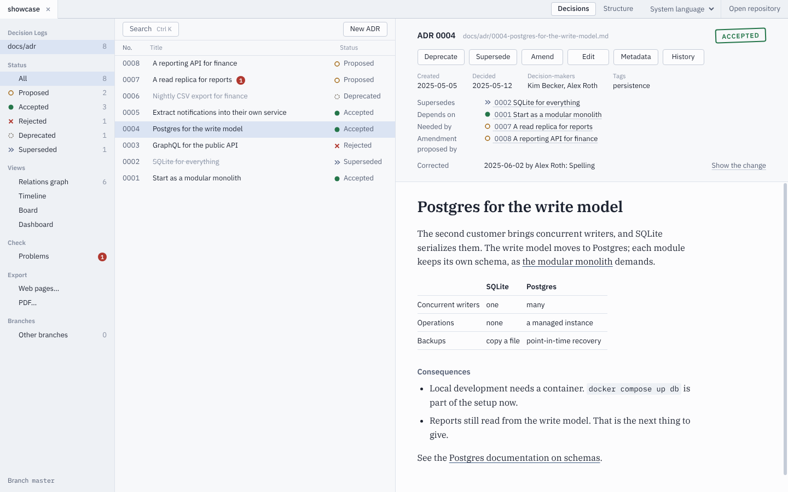
</picture>

Softarch Suite reads ADRs where they already are: Markdown files in a repository, written by people, by agents or by other tools. It lists them, shows how they relate, finds what is inconsistent, and writes new ones and changes to existing ones. Every change is shown as a diff before it is written, and nothing is changed beyond the lines it was asked to change. Markdown is never re-serialized ([ADR-0002](docs/adr/0002-never-reserialize-markdown.md)).

The suite is planned as one workbench of several modules for software architects ([vision](docs/vision.md)). Two of them are built:

- **Decisions** covers the ADRs. It was called ADR Tool until the suite got its name.
- **Structure** shows the Components of the code and the Dependencies between them, and links them to the ADRs that affect them.

The app runs locally: there is no backend, no account and no telemetry.

> [!NOTE]
> Early development. v1 of the Decisions module is accepted and the Structure module is built; the rest of the roadmap is being built part by part ([plan-roadmap.md](docs/plan-roadmap.md)). There are no installers yet: the app runs from source.

## Table of Contents

- [Features](#features)
  - [Decisions](#decisions)
  - [Structure](#structure)
- [Install](#install)
- [Usage](#usage)
- [Development](#development)
- [Documentation](#documentation)
- [Roadmap](#roadmap)
- [Contributing](#contributing)
- [License](#license)

## Features

### Decisions

- **Browse.** The app opens one tab per repository and finds every Decision Log in it. You can filter the ADRs by Status: proposed, accepted, rejected, deprecated or superseded. Each ADR shows its Metadata, its Relations and its Back-references, and its text is rendered.
- **Relations graph.** It shows which ADR supersedes, amends, depends on or relates to which. An ADR stands to the right of what it builds on.

  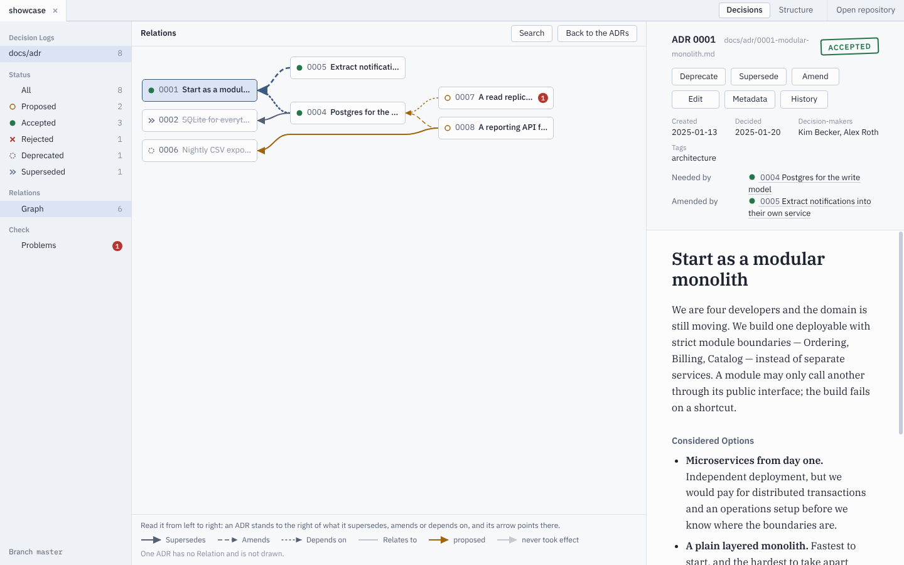

- **Write.** You can create a new ADR from a Template: `minimal`, `nygard`, `madr` or the repository's own. You can Accept, Reject, Deprecate, Supersede, Amend and Renumber. Every operation returns a change set, and you see that change set as a diff of every file it touches before anything is written ([ADR-0004](docs/adr/0004-operations-return-change-sets.md)).

  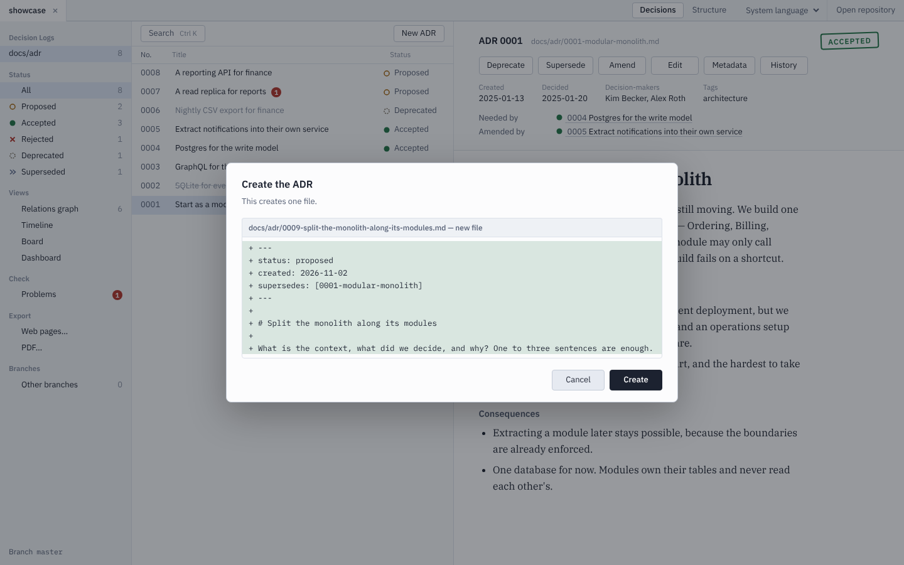

- **Edit.** The editor has three modes: the Markdown source on its own, the source with a live preview, and **Live**, which renders headings, emphasis, links, lists and code in place and shows the source of the line the cursor is in. Every mode saves the same text. Once an ADR is decided, saving records a **Correction**. A Correction never changes what was decided.

  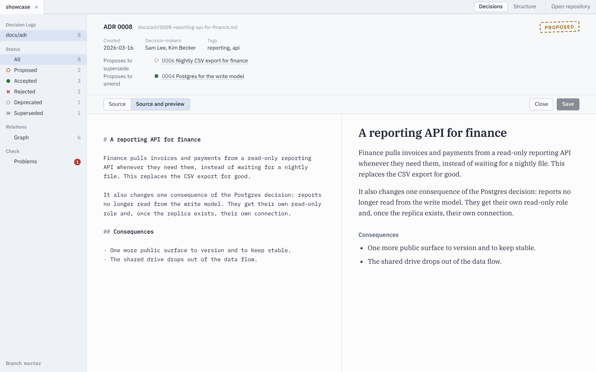

  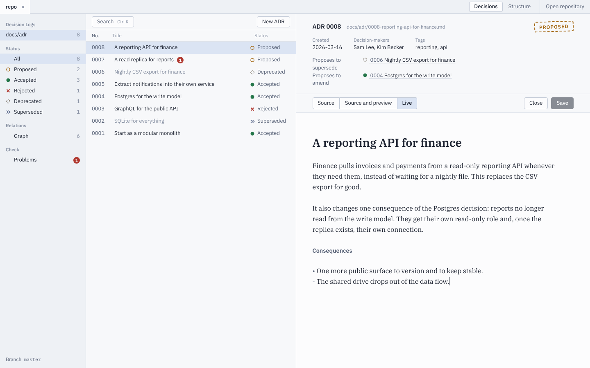

- **Problems and Repairs.** The tool finds broken Relations, inconsistent Back-references, duplicate numbers and invalid Metadata. Each Problem comes with a Repair, which is previewed like any other change.

  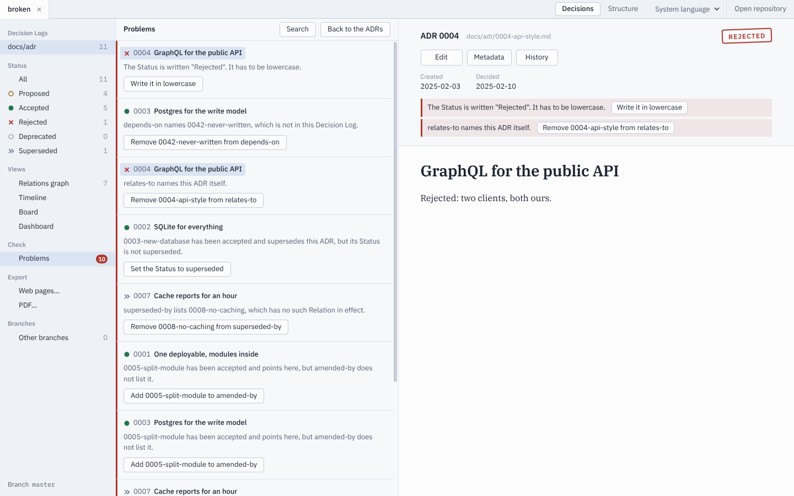

- **Search.** <kbd>Ctrl</kbd> <kbd>K</kbd> (<kbd>⌘</kbd> <kbd>K</kbd> on a Mac) searches the full text instantly: number, title and body.
- **git, read-only.** The app shows the branch that is checked out and the ADRs with uncommitted changes. For each ADR it shows its history, commit by commit, with the diff.
- **Foreign formats.** ADRs written for [MADR](https://adr.github.io/madr/) 3 and 4 and for [adr-tools](https://github.com/npryce/adr-tools) are read as they are. **Migration** converts them into the suite's own format, as a previewed change ([ADR-0005](docs/adr/0005-foreign-formats-are-read-never-written.md)).
- Light and dark themes, following the system.

<details>
<summary>More screenshots: Metadata, search, history, Migration</summary>

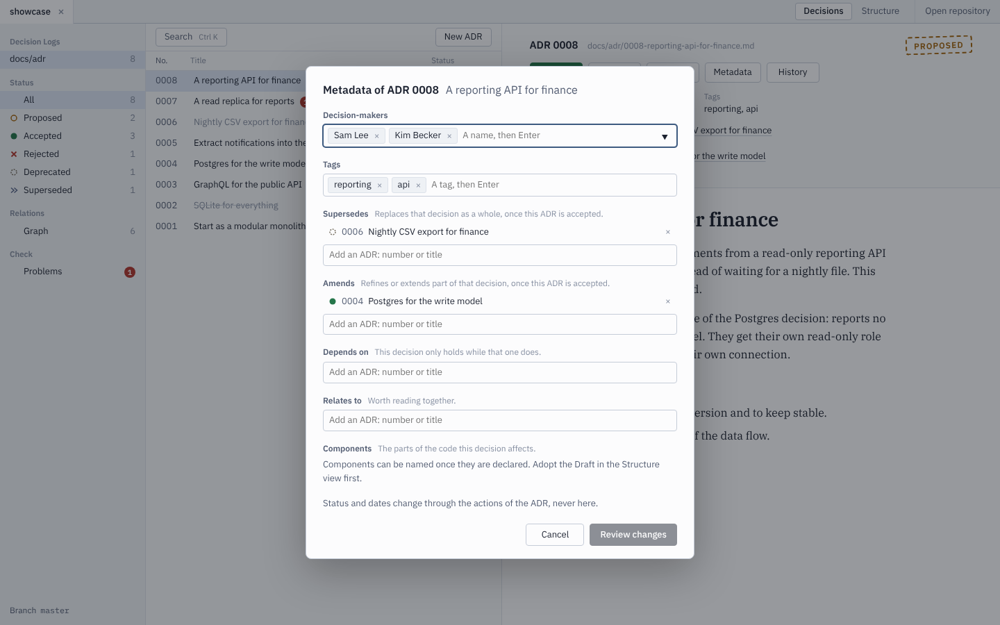

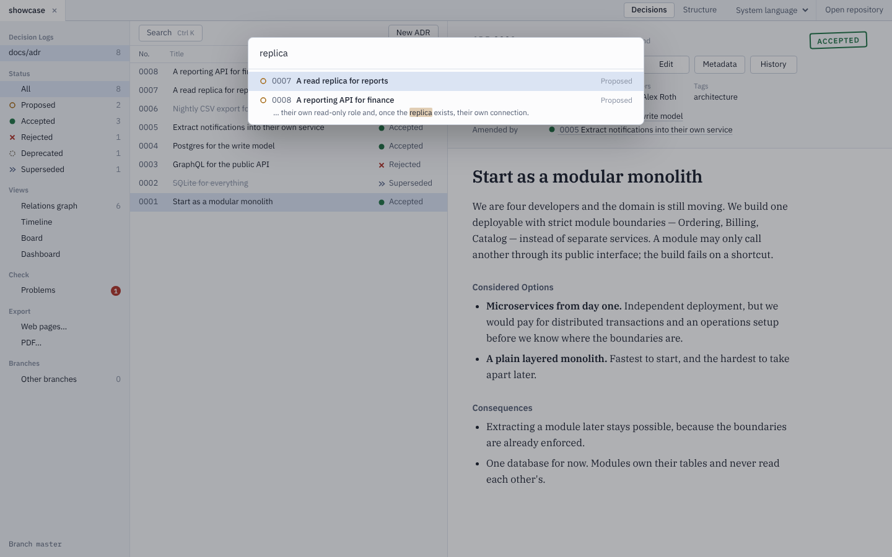

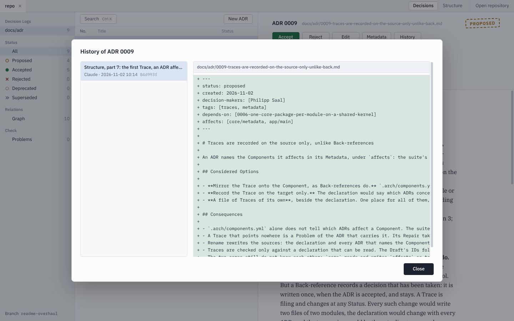

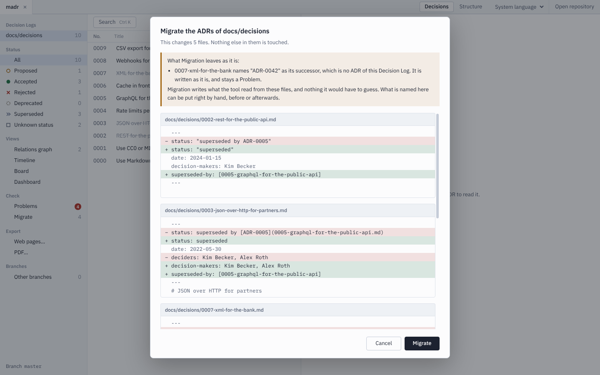

</details>

### Structure

- **Components.** Components are declared in `.arch/components.yml`. Until something is declared, the app derives a **Draft** from the build files and the folders: pnpm and npm workspaces, Maven modules, Gradle projects. The Draft is marked as a proposal everywhere it is shown, and **Adopt** writes it as a previewed change.

  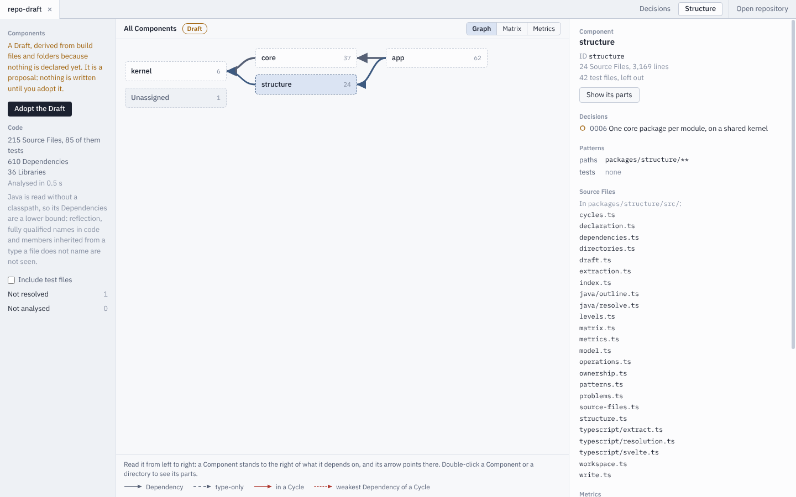

- **Dependencies and Cycles.** The app reads TypeScript, JavaScript, Svelte and Java with parsers alone. It never runs anything from the repository it analyses ([ADR-0007](docs/adr/0007-the-analysis-never-executes-anything-from-the-analysed.md), [ADR-0008](docs/adr/0008-dependencies-come-from-parsers-alone-without-a-type-checker.md)). Each level is drawn as a graph. A Cycle is shown with an example round trip and its weakest Dependency.

  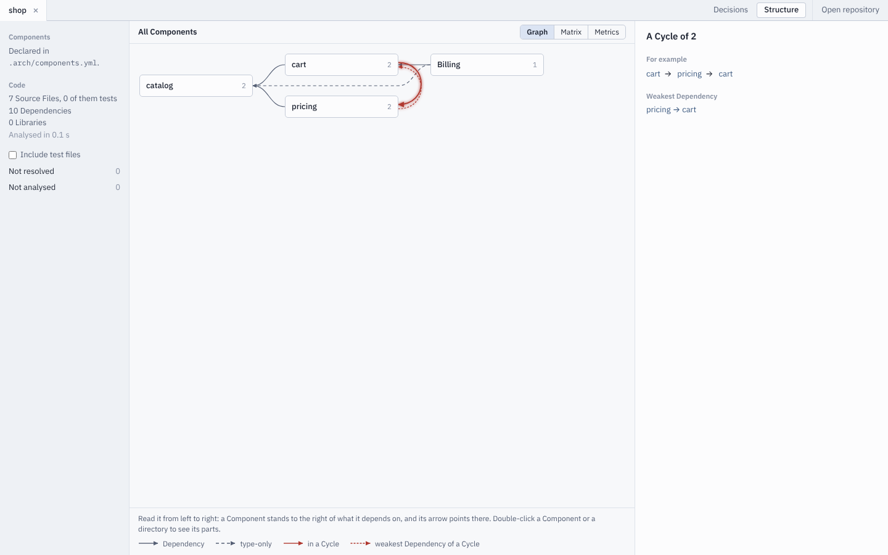

- **Dependency structure matrix.** Each row shows the Dependencies of one Component, and what lies above the diagonal closes a Cycle. A row expands into the parts of its Component.

  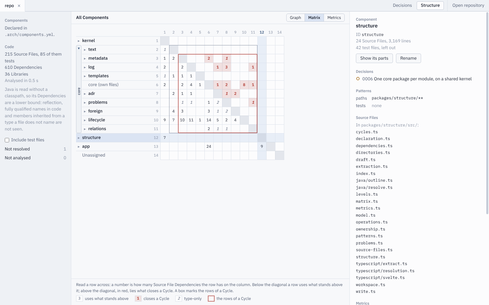

- **Metrics.** The metrics table shows, for each Component:
  - size: Source Files and lines;
  - efferent and afferent coupling;
  - instability;
  - fan-out and fan-in;
  - relational cohesion;
  - internal share.

  Each metric has its definition on its column heading.

  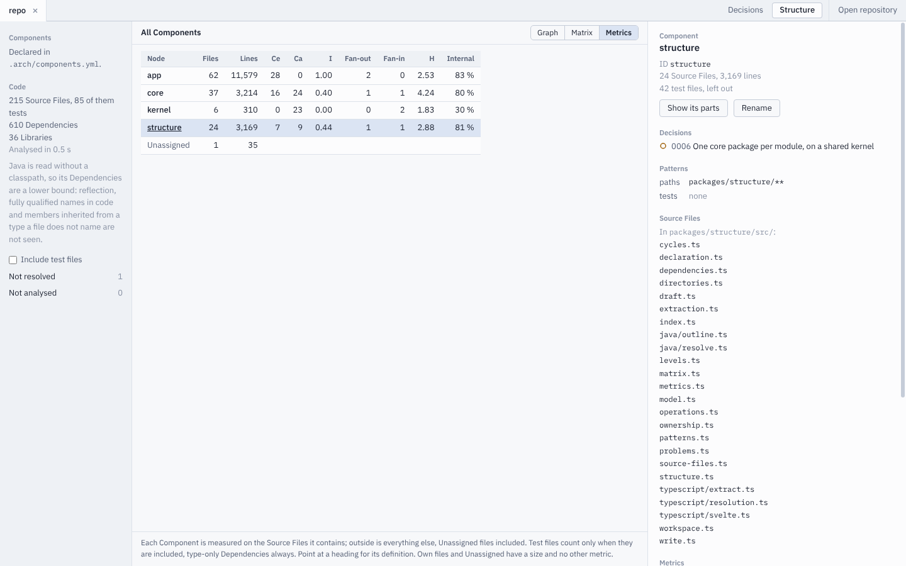

- **From a line to the code.** Click a line in the graph, then one of its line numbers. The Source File opens in a read-only viewer, with the import behind the Dependency marked.

  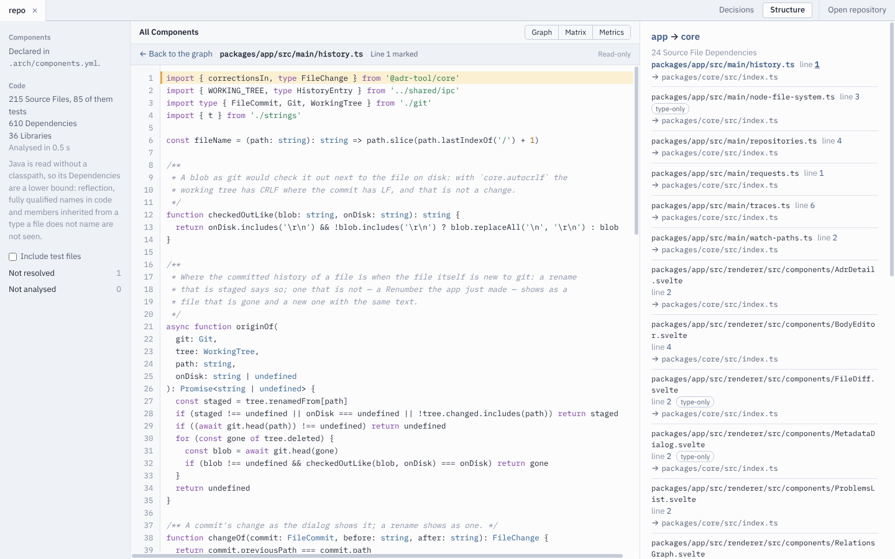

- **As deep as the folders go.** Below a Component without children, the levels continue through its directories down to single files. Each directory has its own graph, matrix row, metrics and page. Directories are part of the view only: nothing declares them, and nothing writes them.

  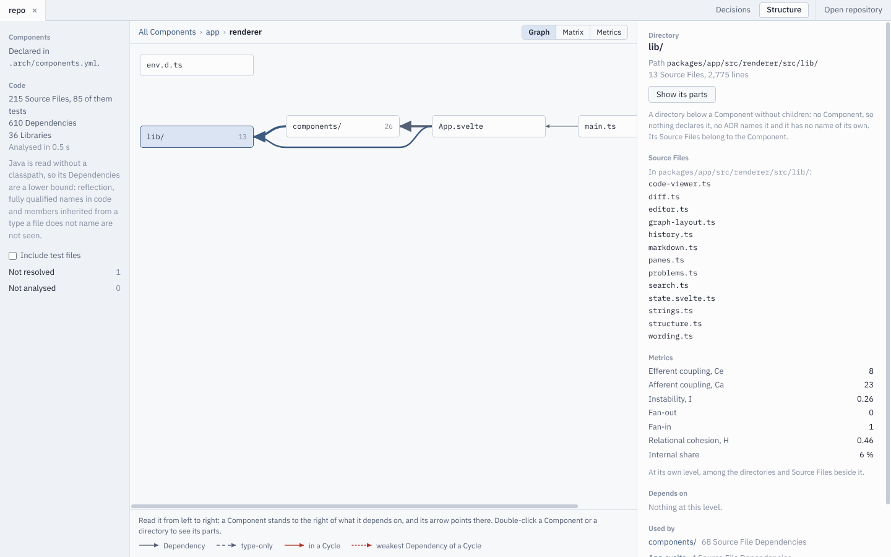

- **Traces and Rename.** An ADR names the Components it affects. The page of a Component lists those ADRs ([ADR-0009](docs/adr/0009-traces-are-recorded-on-the-source-only-unlike-back.md)). **Rename** gives a Component a new name and rewrites the declaration and every ADR that names it in one previewed change.

  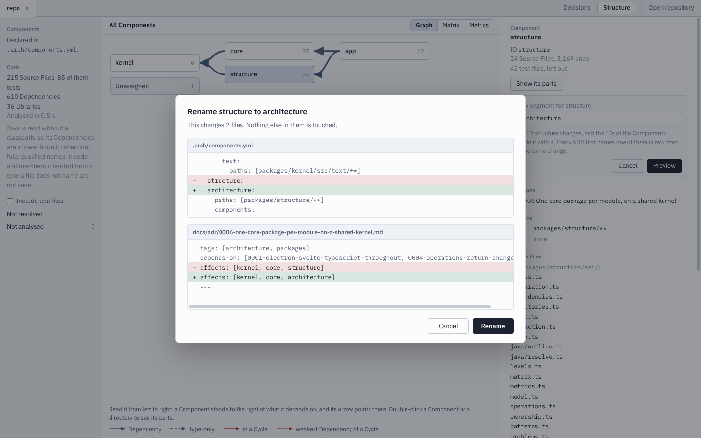

The analysis runs in a worker thread and caches its results per file. It follows changes on disk while the view is open.

## Install

Requirements:

- [Node.js](https://nodejs.org/) 22.12 or newer.
- [pnpm](https://pnpm.io/) 11. With `corepack enable`, the version pinned in `package.json` is used.
- git, optional. Without it, the history and the uncommitted changes are not shown.

```bash
git clone https://github.com/CyphraX/adr-tool.git
cd adr-tool
pnpm install
```

`pnpm install` also downloads Electron. CI builds and tests on Linux. Windows and macOS are switched off in CI until distribution (see the [roadmap](docs/roadmap.md)).

## Usage

Start the app in development mode:

```bash
pnpm dev
```

**Open repository**, at the top right, opens the folder of a repository in a new tab. Each tab switches between **Decisions** and **Structure**. On the next start, the app reopens the repositories of the last run.

`ADR_TOOL_REPO` opens one more repository at start. Give it the full path, because `pnpm dev` runs in `packages/app`:

```bash
ADR_TOOL_REPO="$PWD/packages/core/test/fixtures/showcase" pnpm dev
```

### Sample repositories

The test fixtures are useful for exploring the app. They are test data, so copy one before you try anything that writes.

| Path | What it shows |
| --- | --- |
| `packages/core/test/fixtures/showcase` | Every Status, supersedes, amends and depends-on, and one Problem |
| `packages/core/test/fixtures/broken` | Ten Problems, each with its Repair |
| `packages/core/test/fixtures/madr`, `…/adr-tools` | Foreign formats, offered for Migration |
| `packages/structure/test/fixtures/shop` | A Cycle between two Components with its weakest Dependency, and one between two files |
| `packages/structure/test/fixtures/maven-shop` | Java: a Maven project of three modules, with one package spread over two of them |
| this repository | Its own ADRs, and its packages as declared Components |

### Where ADRs are found

The app looks in the following places, in this order, and stops at the first one that has anything:

1. `.adr/config.yml`
2. adr-tools' `.adr-dir`
3. the folders `docs/adr`, `doc/adr` and `docs/decisions`

Opening a repository never writes anything. The first ADR of a repository goes into `docs/adr`.

An ADR is a Markdown file with its Metadata in front matter:

```markdown
---
status: accepted
created: 2025-05-05
decided: 2025-05-12
decision-makers: [Kim Becker, Alex Roth]
supersedes: [0002-sqlite-for-everything]
affects: [billing]
---

# Postgres for the write model

The second customer brings concurrent writers, and SQLite serializes them. …
```

The complete contract, including Templates, every operation and the foreign formats, is [docs/file-format.md](docs/file-format.md). It is written so that people and agents can write valid ADRs without the app.

### Declaring Components

```yaml
# .arch/components.yml
components:
  core:
    name: Domain core
    paths: [packages/core/src/**]
    components:
      metadata:                 # Component ID: core/metadata
        paths: [packages/core/src/metadata/**]
  app:
    paths: [packages/app/src/**]
```

The patterns, test files, the Draft, the Dependencies of each language and the definitions of the metrics are in [docs/structure-format.md](docs/structure-format.md).

## Development

| Command | What it does |
| --- | --- |
| `pnpm dev` | Runs the app with hot reload |
| `pnpm build` | Builds every package |
| `pnpm test` | Runs every package's tests with Vitest |
| `pnpm typecheck` | Runs `tsc`, and `svelte-check` for the renderer |
| `pnpm lint` | Runs ESLint |
| `pnpm format` / `pnpm format:check` | Runs Prettier, writing or checking |

CI runs `lint`, `format:check`, `typecheck`, `test` and `build` on every pull request.

### Project layout

A pnpm monorepo. Each module of the suite has one UI-free core package, and the module cores never depend on each other ([ADR-0006](docs/adr/0006-one-core-package-per-module-on-a-shared-kernel.md)).

| Package | Contents |
| --- | --- |
| [`packages/kernel`](packages/kernel) | What every module needs and none owns: the file-system port, splice edits, change sets |
| [`packages/core`](packages/core) | The core of the Decisions module in pure TypeScript. No Electron, no DOM and no disk access of its own; its type check fails if it reaches for any of them |
| [`packages/structure`](packages/structure) | The core of the Structure module, under the same guard: Components, Source Files, the Draft, Dependencies, Cycles, the metrics and the matrix. Java is read with `tree-sitter-java` as WebAssembly. Its entry `@adr-tool/structure/model` holds everything except the parsers |
| [`packages/app`](packages/app) | The Electron + Svelte 5 desktop app ([ADR-0001](docs/adr/0001-electron-svelte-typescript-throughout.md)). The renderer is sandboxed and reaches the main process only through the preload bridge. The analysis runs in a worker thread |

### Conventions

- **Language.** Code and documents use the terms of [CONTEXT.md](CONTEXT.md) (Decisions) and [docs/contexts/structure/CONTEXT.md](docs/contexts/structure/CONTEXT.md) (Structure). [CONTEXT-MAP.md](CONTEXT-MAP.md) maps the two.
- **Decisions.** Every decision of consequence is recorded as an ADR in [docs/adr/](docs/adr/), written in the suite's own format.
- **Bytes.** Prettier never formats Markdown in this repository. The fixtures under `packages/core/test/fixtures` are exempt from git's line-ending normalization. The tool promises never to change a byte it was not asked to change, and this repository is its first test case.
- **Text.** All text of the window lives in `packages/app/src/renderer/src/lib/strings.ts` and `wording.ts`, ready for translation. A test checks that no component carries text of its own.

## Documentation

| Document | Contents |
| --- | --- |
| [docs/vision.md](docs/vision.md) | Where the project is heading: Decisions as the first module of an architect's suite |
| [docs/roadmap.md](docs/roadmap.md) | What is in v1, what comes before the first public release, and what comes after |
| [docs/plan.md](docs/plan.md) | The milestones of the Decisions module, with their status |
| [docs/plan-structure.md](docs/plan-structure.md) | The parts of the Structure module, with their status |
| [docs/plan-roadmap.md](docs/plan-roadmap.md) | The parts of the rest of the roadmap, with their status |
| [docs/file-format.md](docs/file-format.md) | The on-disk contract of ADRs and Decision Logs |
| [docs/structure-format.md](docs/structure-format.md) | The contract of the Structure module: declaration, Dependencies, levels, metrics |
| [docs/adr/](docs/adr/) | The decisions this project rests on |
| [CONTEXT.md](CONTEXT.md), [CONTEXT-MAP.md](CONTEXT-MAP.md) | The domain language and how its contexts relate |

## Roadmap

- **Decisions:** v1 is built and accepted ([plan.md](docs/plan.md)).
- **Structure:** parts 1 to 8 are built ([plan-structure.md](docs/plan-structure.md)).
- **The rest of the roadmap** is being built part by part ([plan-roadmap.md](docs/plan-roadmap.md)):
  - the known gaps before the first release and the live editor (built);
  - an `adr lint` CLI for CI;
  - MADR 2.x and log4brains;
  - Relations across Decision Logs, committing an ADR, a branch overview;
  - an MCP server for agents;
  - export, timeline, board and dashboard;
  - a German translation, and the repositories in the window seen together.
- **Deferred:** distribution — installers, code signing and auto-update.

The details are in [docs/roadmap.md](docs/roadmap.md).

## Contributing

Changes go through pull requests against `main`, and CI must pass. Before you open one:

1. Run the five CI checks locally: `pnpm lint`, `pnpm format:check`, `pnpm typecheck`, `pnpm test` and `pnpm build`.
2. Use the terms of the glossaries.
3. Write down a decision of consequence as an ADR.
4. Update the specification of the format first when behaviour changes. That is [docs/file-format.md](docs/file-format.md) or [docs/structure-format.md](docs/structure-format.md).

## License

[MIT](LICENSE) © 2026 Philipp Saal ([ADR-0010](docs/adr/0010-the-suite-is-open-source-under-the-mit-licence.md)).
